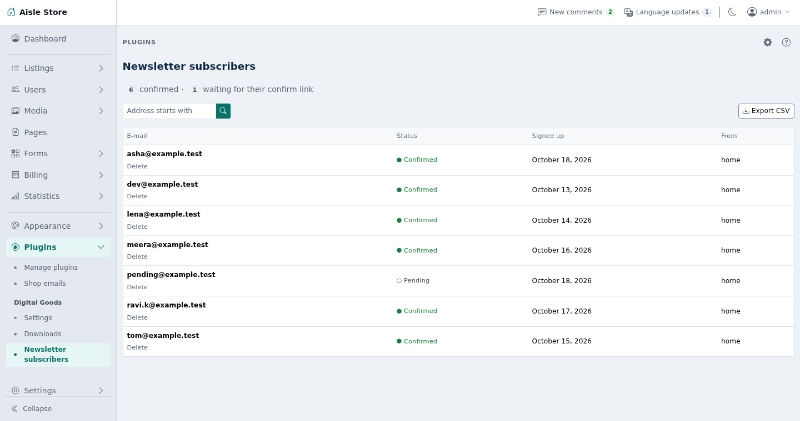
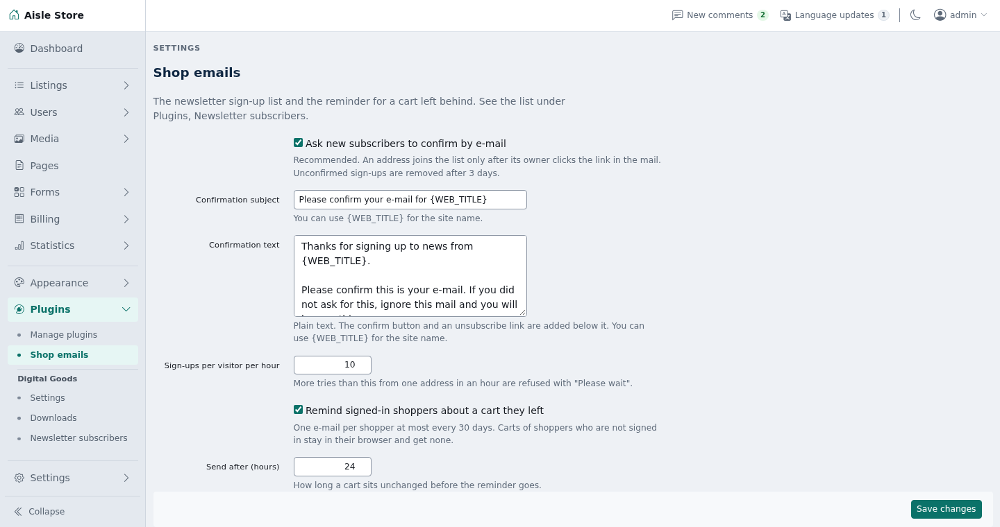
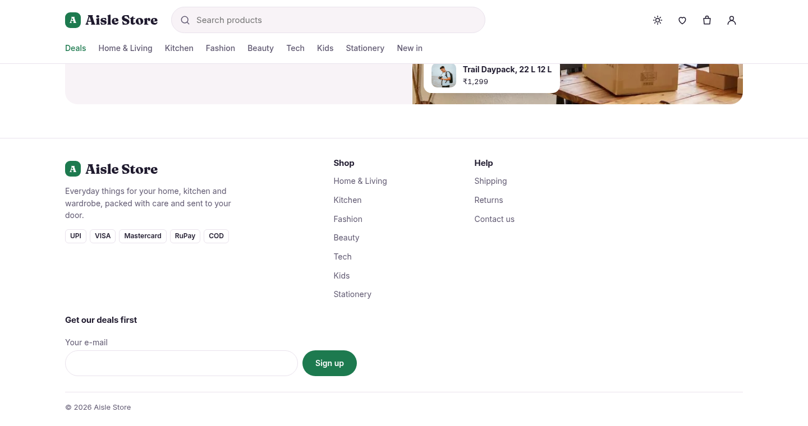

# Shop emails

A newsletter sign-up list with double opt-in and CSV export, and one reminder e-mail for a signed-in shopper who leaves a cart.

The newsletter works on classifieds and shop sites. The cart reminder is for shop sites only.

## Requirements

- Shopclass 7.1.0 or later
- PHP 8.2 or later
- No outside accounts. The reminder runs on the hourly cron and job queue. Core's auto-cron drives them; a system cron or worker only makes them run on time.

## Install

1. Open **Plugins → Browse** (or upload the zip from the GitHub release).
2. Install.
3. Activate.

## Set up

1. Open **Settings → Email → Shop emails**.
2. Set the newsletter options:

   | Setting | Default |
   |---|---|
   | Ask new subscribers to confirm by e-mail | On |
   | Confirmation subject, Confirmation text | A short "please confirm" mail |
   | Sign-ups per visitor per hour | 10 |

3. On a shop site, set the cart reminder options (a classifieds site does not show them):

   | Setting | Default |
   |---|---|
   | Remind signed-in shoppers about a cart they left | On |
   | Send after (hours) | 24 |
   | Skip carts older than (days), counted after the wait | 7 |
   | Reminder subject, Reminder text | "You left something in your cart" |
   | Cart link | The home page with `#cart` |
   | Reminders per hourly run | 50 |

4. Show the form: open **Appearance → Manage widgets** and add **Newsletter sign-up** to a widget area. Set its heading, field label and button text. A theme with its own form can post to the plugin instead (see For developers).
5. See who signed up under **Users → Newsletter subscribers**.

Texts are plain. A blank line starts a new paragraph. `{WEB_TITLE}` is the site name. `{USER_NAME}` is the shopper's name in the reminder.

With the Aisle theme, its home page newsletter form works once the plugin is active. Aisle opens its cart drawer for the `#cart` link.

## How it works

Newsletter:

- A theme's form posts `email` to `shop-emails/subscribe`. The plugin checks the address, a hidden `website` field that only bots fill, and the hourly limit per visitor.
- The visitor returns to the page they came from with `?newsletter=sent|confirmed|exists|invalid|wait`.
- `sent`: a confirm mail went out (also the answer to a bot). `confirmed`: double opt-in is off. `exists`: already confirmed. `invalid`: not an e-mail address, or over 191 characters. `wait`: over the limit, or the mail could not be sent.
- The confirm mail has a confirm link and an unsubscribe link. Each carries a random token, not the address. The unsubscribe link asks first, so a mail scanner cannot remove anyone.
- A second sign-up of a pending address within 10 minutes sends nothing. Later, it sends a new link and the old one stops working.
- Unconfirmed sign-ups are removed after 3 days.
- **Newsletter subscribers** shows counts, the list, a search by the start of an address, and Delete. **Export CSV** downloads confirmed addresses (`email,status,source,signed_up,confirmed_at`, times in UTC).

Cart reminder (shop sites only):

- Once an hour, the plugin reads saved carts of signed-in shoppers and queues a reminder for each cart that has items, has not changed for the set hours, and belongs to a live account with an e-mail.
- The job checks again before sending. A cart emptied, changed or ordered since gets nothing.
- The mail lists up to five items with price and links to the cart.
- A shopper gets at most one reminder in 30 days. Placing an order also stops one.
- Each run reads at most 500 carts and queues at most **Reminders per hourly run**. The next run carries on.

## Notes / limits

- The plugin does not send newsletters.
- Guests' carts live in the browser and get no reminder.
- Everything is in core's `t_key_value` table, groups `newsletter`, `newsletter_token`, `cart_reminder` and `shop_emails`. No table of its own. Settings are preferences in the `shop-emails` section.
- The visitor's IP is never stored. The hourly limit uses core's rate counter, which keeps a hash.
- Personal data: core's data export includes the account's newsletter row and reminder mark. Deleting an account deletes both. Delete one address under **Users → Newsletter subscribers**, or the person can use the unsubscribe link.
- Uninstalling deletes the list, links, marks and settings. Export the list first.
- On an older Shopclass the plugin loads, does nothing and says so in the admin.

## For developers

- The filter `aisle_newsletter_action` returns the subscribe address. Another theme can call `shop_emails_subscribe_url()` and post a form with an `email` field to it.
- Show a line for each `?newsletter=` status. Print only the five values above.
- An optional `source` field (`a-z`, `0-9`, `_`, `-`, up to 20 characters) names the form. It defaults to `home`.
- Mail text passes through filters before placeholders are filled: `shop_emails_confirm_title`, `shop_emails_confirm_description` (`$text, $email`), `shop_emails_reminder_title`, `shop_emails_reminder_description` (`$text, $user, $lines`). The description filters get HTML, so escape what you add.
- Listens to `aisle_newsletter_action`, `personal_data_export`, `cron_hourly`, `register_jobs`, `billing_order_placed` and `delete_user`.

Translations: copy `languages/shop-emails.pot` to `languages/<locale>/messages.po`, translate, and compile to `messages.mo`. Rebuild the template with `php tools/make-pot.php`.

Tests: `./tests/run.sh` (unit) and `php tests/integration/flow.php` (needs core's scratch MySQL on port 33061).

## Support

[GitHub issues](https://github.com/mindstellar/shopclass-plugin-shop-emails/issues)

## License

GPL-3.0-or-later. See [LICENSE](LICENSE).
